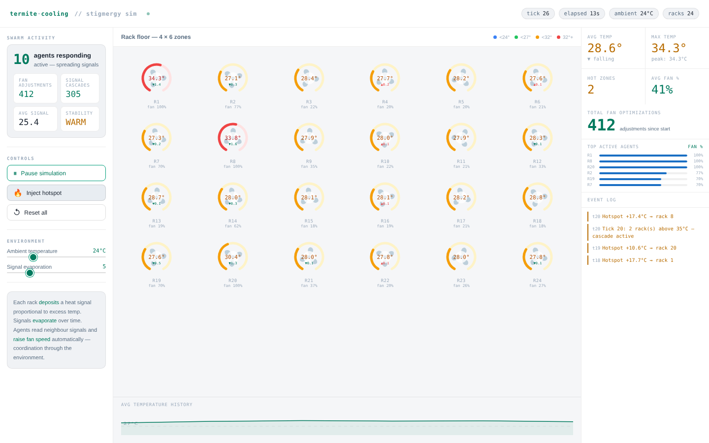
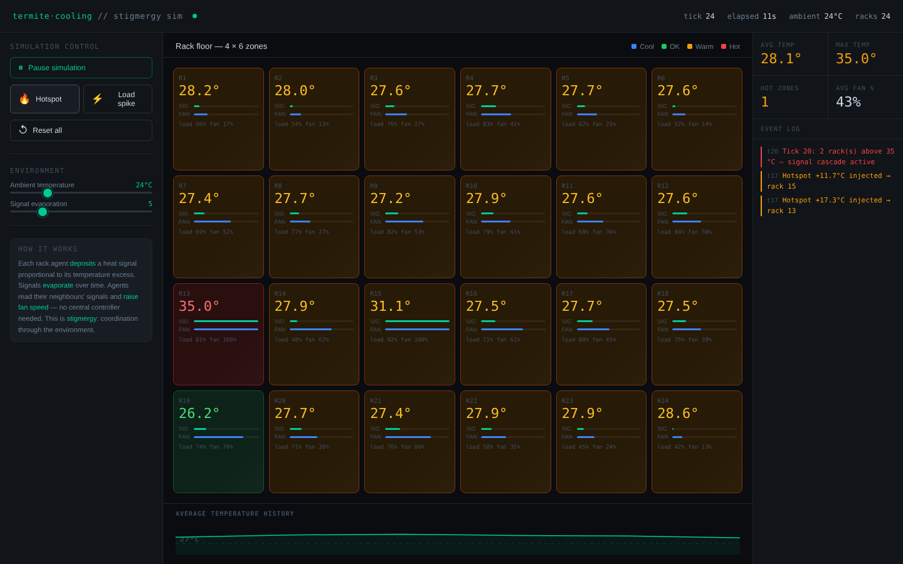
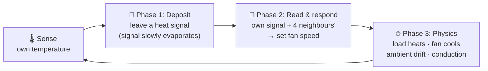

<div align="center">

# 🐜 Termite Swarm Cooling

### Self-organising data center cooling inspired by termite mounds

A swarm intelligence simulation where 24 server racks keep themselves cool **without any central controller**. Each rack follows simple local rules, and stable temperature control *emerges* from the swarm, just like termites keep their mounds at a near-constant temperature.


<br>



<sub><i>Three hotspots injected: the hot racks (red) and their neighbours spin their fans up on their own, with no rack telling another what to do.</i></sub>

</div>

---

## 📑 Contents

- [The Idea](#-the-idea)
- [Two Ways to Run It](#-two-ways-to-run-it)
- [The Stigmergy Algorithm](#%EF%B8%8F-the-stigmergy-algorithm)
- [Dashboard](#%EF%B8%8F-dashboard)
- [Swarm Intelligence Concepts](#-swarm-intelligence-concepts)
- [Parameters](#%EF%B8%8F-parameters)
- [Project Structure](#-project-structure)
- [License](#-license)

---

## 💡 The Idea

Termite mounds stay at a near-constant temperature even when the outside temperature swings wildly. No termite is in charge. Each one reacts only to **local cues** in its surroundings, such as heat or pheromones, and changes the environment for the others. This indirect coordination through the environment is called **stigmergy**.

This project applies the same principle to a data center:

- 🗄️ Each of the **24 racks** (a 4 × 6 grid) is an independent agent
- 🌡️ A rack only senses **its own temperature** and the heat signals of its **4 direct neighbours**
- 📡 Racks never talk to each other directly. They only leave a **heat signal** in the shared environment, the digital equivalent of a pheromone
- 🌀 Each rack sets **its own fan speed** from those local signals
- ✨ Stable cooling of the whole room **emerges** without any rack knowing the global state

---

## 🚀 Two Ways to Run It

### Option 1: Browser version (no installation)

The file [`docs/index.html`](docs/index.html) contains the complete simulation, ported to JavaScript, with the full dashboard. Download it and open it in any browser.

> 🌐 **Live demo:** this file can be published with GitHub Pages, so anyone can try the simulation in their browser (see [Publishing the live demo](#-publishing-the-live-demo)).

### Option 2: Python / Flask version

The original implementation: the simulation runs in **Python** on a background thread, and a dashboard reads its state through a small REST API.

```bash
git clone https://github.com/Aditya74747/termite-swarm-cooling.git
cd termite-swarm-cooling
pip install -r requirements.txt
python app.py
```

Then open **http://localhost:5000**.



<details>
<summary><b>REST API</b></summary>

| Method | Endpoint | Body | What it does |
|---|---|---|---|
| `GET` | `/api/state` | – | Full simulation state: all racks, stats, history, event log |
| `POST` | `/api/control` | `{"action": "add_hotspot", "rack_index": 3}` | Heat up one rack by 10–18 °C |
| `POST` | `/api/control` | `{"action": "add_random_load_spike"}` | Raise the compute load of a random rack |
| `POST` | `/api/control` | `{"action": "set_ambient", "value": 30}` | Change the room temperature |
| `POST` | `/api/control` | `{"action": "set_evaporation", "value": 8}` | Change how fast heat signals fade |
| `POST` | `/api/control` | `{"action": "set_load", "rack_index": 0, "value": 0.9}` | Set one rack's load (0–1) |
| `POST` | `/api/control` | `{"action": "toggle_pause"}` | Pause or resume |
| `POST` | `/api/control` | `{"action": "reset"}` | Reset all 24 agents |

The simulation steps every **500 ms**, and the dashboard polls `/api/state` every **600 ms**.

</details>

---

## ⚙️ The Stigmergy Algorithm

Every **tick (500 ms)** each rack goes through three phases:



### Phase 1: Deposit

Each rack adds to its heat signal in proportion to how far it is **above the 27 °C target**. The signal also loses a fixed amount every tick, the way pheromones evaporate.

```
excess       = max(0, temperature − 27 °C)
heat_signal += excess × 2.5
heat_signal −= evaporation_rate
heat_signal  = clamp(heat_signal, 0, 120)
```

### Phase 2: Read and respond

A rack combines its own signal with the **average of its neighbours' signals** and sets its fan speed from that. It never sees the global average temperature.

```
effective_signal = 0.65 × own_signal + 0.35 × neighbour_average
fan_speed        = min(100 %, effective_signal × 1.9)
```

### Phase 3: Physics

```
Δtemp = load × 0.6                          ← heat from the servers
      − fan_speed × 0.013                   ← cooling from the fan
      + (ambient − temp) × 0.008            ← drift toward room temperature
      + Σ(neighbour_temp − temp) × 0.02     ← heat conduction between racks
      + noise(−0.04 … +0.04)                ← keeps the system from freezing in place
```

Because neighbours share their signals, a hotspot also makes the **surrounding racks** spin up. That's a *signal cascade*: the swarm spreads the cooling effort outward from the problem.

---

## 🖥️ Dashboard

| Panel | Contents |
|---|---|
| **Left: Controls** | Pause / resume, inject hotspot, load spike, reset, sliders for ambient temperature (18–42 °C) and signal evaporation (1–20), and swarm activity counters (agents responding, fan adjustments, signal cascades, stability) |
| **Centre: Rack floor** | 4 × 6 grid of racks showing temperature, fan speed, heat signal and load, colour-coded from cool 🔵 to OK 🟢, warm 🟠 and hot 🔴. **Click any rack** to inject a hotspot there. Below it, a sparkline of the average temperature. |
| **Right: Stats & log** | Average and max temperature, hot zones (> 32 °C), average fan speed, the most active agents, and a live event log |

In the browser version, each rack is drawn as a **gauge with a spinning fan**: the arc fills as the temperature rises, and the fan spins faster as its speed goes up.

---

## 🧠 Swarm Intelligence Concepts

| Concept | How it appears here |
|---|---|
| **Stigmergy** | Racks coordinate only through `heat_signal` in the shared environment, never by direct messages |
| **Emergence** | Room-wide temperature control comes from 24 agents each following the same simple local rule |
| **Decentralisation** | There is no master controller and no single point of failure |
| **Scalability** | Each rack only looks at 4 neighbours, so every tick is O(N) however big the grid is |
| **Adaptation** | Inject a hotspot anywhere and the neighbourhood reacts within a few ticks |

---

## 🎛️ Parameters

| Parameter | Default | Effect |
|---|---|---|
| `TARGET_TEMP` | 27 °C | ASHRAE A1 recommended inlet temperature; signals are only deposited above this |
| `MAX_SIGNAL` | 120 | Upper limit for a rack's heat signal |
| Ambient temperature | 24 °C | Room temperature that idle racks drift toward |
| Evaporation rate | 5 | Signal lost per tick; higher means faster fading and a calmer response |
| Own / neighbour weight | 0.65 / 0.35 | How much a rack trusts its own signal compared with its neighbours' |
| Fan multiplier | 1.9 | Converts the effective signal into fan % |
| Heat generation | load × 0.6 | °C added per tick from the compute load |
| Fan cooling | fan × 0.013 | °C removed per tick per % of fan speed |

All of these live in [`simulation/rack_agent.py`](simulation/rack_agent.py) and [`simulation/datacenter.py`](simulation/datacenter.py), so you can experiment with them.

---

## 📂 Project Structure

```
termite-swarm-cooling/
├── app.py                    Flask app: background simulation thread + REST API
├── requirements.txt
├── simulation/
│   ├── rack_agent.py         One rack agent: deposit, read & respond, physics
│   └── datacenter.py         The 4 × 6 grid: neighbours, simulation steps, events
├── templates/
│   └── index.html            Dashboard for the Flask version
├── static/js/
│   └── dashboard.js          Polls the API and renders the rack floor
└── docs/
    ├── index.html            Standalone browser version (no server needed)
    └── images/               Screenshots
```

---

## 🌐 Publishing the live demo

1. In the repository go to **Settings → Pages**
2. Under **Build and deployment**, choose **Deploy from a branch**
3. Select branch **`main`** and folder **`/docs`**, then click **Save**

After a minute the simulation is live at
**https://aditya74747.github.io/termite-swarm-cooling/**

---

## 📄 License

This project is released under the [MIT License](LICENSE).
